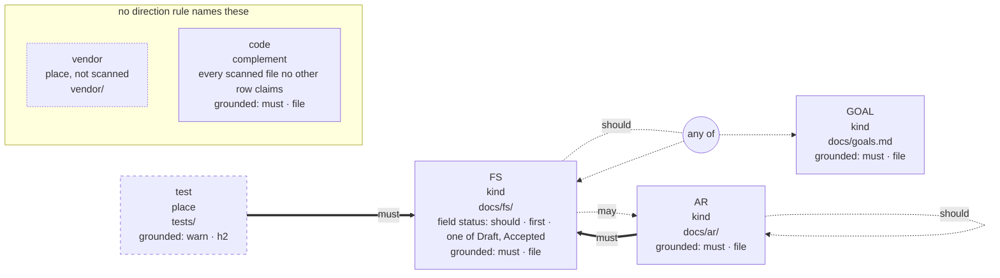

# Seeing a repository's schema

`grund schema` prints what a repository is held to, on one screen: which kinds
exist and where they live, which folders are places rather than ID namespaces,
what shape each kind's declarations must have, which units must be grounded, and
who must cite whom and how strongly. It reads the effective configuration and
nothing else, so it answers before the first declaration is written and on a tree
whose citations are broken. The contract is
[§FS-schema](../functional-spec/FS-schema.md#fs-schema-grund-schema-shows-what-a-repository-is-held-to-read-from-its-configuration-alone); the runnable
[`examples/schema/`](../../examples/schema/) repository prints everything below.

```bash
grund schema                         # the quick terminal view
grund schema --format mermaid        # Mermaid source, e.g. for a GitHub comment
grund schema --format dot | dot -Tsvg > schema.svg
grund schema docs/ --path-base=invocation
```

The configuration is discovered from `PATH` exactly as `grund config show`
discovers it. A path inside a workspace member shows that member; at a workspace
root the view is of the root project, and its last line names the members to run
`grund schema <member>` on. `grund config show` stays the effective TOML, every
value filled in.

With no `grund.toml` at or above `PATH`, the header reads `defaults, no grund.toml`
and the view is the built-in defaults a config-less tree is held to. The line
under it says so, and names the version and the kinds the config
`grund init --scaffold` would write adds to them, so a schema read before `init`
does not look like a preview of what `init` lays down ([§FS-schema.8.2](../functional-spec/FS-schema.md#82-with-no-grundtoml-a-note-names-what-grund-init---scaffold-writes)).

## The table

```text
example · grund.toml · v2

kinds and places
  GOAL    kind                docs/goals.md
  FS      kind                docs/fs/
            field status      should · first · one of Draft, Accepted
  AR      kind                docs/ar/
  test    place               tests/
  vendor  place, not scanned  vendor/
  code    complement          every scanned file no other row claims

citations                     grounded
  GOAL    —                   must · file
  FS      should  GOAL|FS     must · file
          may     AR
  AR      must    FS          must · file
          should  AR (itself)
  test    must    FS          warn · h2
  code    —                   must · file
  vendor  not scanned: cites nothing and is never checked

must = check error · warn = check warning · should = suggestion (check --suggestions)
may = allowed · must not / warn not / should not = forbidden at that strength
A|B = one obligation, met by citing either · — = no direction rule names it
```

- **kinds and places.** One line per row of the configuration, its class as a
  word: `kind` declares IDs, `place` is a folder whose files cite and are
  checked but declare nothing, `place, not scanned` is never read, and the
  `complement` is every scanned file no other row claims. A kind's fields follow
  it, one `field` line each: presence, placement, what the chapter may say,
  and last the heading title the field is held to, where it sets one
  (``field terms  must · first · titled `Terms` ``).
  A row with several places lists every one, comma-separated in written order
  (`docs/a/, docs/b/`). In a version-2 config, a `code` row that lists places
  is the complement, drawn with those places (`crates/, scripts/`) and no
  second complement beside it; [`examples/places/`](../../examples/places/)
  shows one.
- **citations.** One line per direction rule, in row order and then from the
  strongest strength down. `GOAL|FS` is one obligation, met by citing either;
  `AR (itself)` is a kind citing its own kind. `—` is a row with no direction
  rule. A subject's `default` other than `may` is shown as `everything else`.
- **grounded.** The grounding ladder each row is held to, as `<strength> · <unit>`
  rungs: the project's ladder, or the row's own. A row that need not be grounded
  shows nothing, and a table in which no row is grounded has no such column.

## The legend

| word | meaning |
|---|---|
| `must` | a `grund check` error |
| `warn` | a `grund check` warning |
| `should` | a suggestion, under `grund check --suggestions` |
| `may` | allowed |
| `must not`, `warn not`, `should not` | forbidden, at that strength |

A place's or the complement's `must`, `warn` and `should` judge only its files
that cite something: a file that cites nothing passes them, and only grounding
makes it a finding. Where some scanned place or the complement carries one of
them and has no `grounded` badge, the legend says so in a fourth line:

```text
must/warn/should skip an uncited file of a place or the complement · [rules.citations.<ROW>.grounding] makes it a finding
```

A version-1 config reads `require_grounding` in its place. The example above
grounds both its place and the complement, so it has no such line;
[`examples/places/`](../../examples/places/) shows one
([§FS-schema.8.3](../functional-spec/FS-schema.md#83-the-legend-says-an-obligation-skips-an-uncited-file)).

## Mermaid and DOT

`--format mermaid` and `--format dot` print the same facts as graph source on
stdout; grund runs neither Mermaid nor Graphviz. Every edge carries its strength
as a word and as a line style — thick for `must`, solid for `warn`, dashed or
dotted below — and a prohibition ends in a cross or a tee. An any-of entry is
drawn through one `any of` junction, so one obligation stays one line from its
subject; grounding is printed on its row's node, never drawn as an edge; and a
row no direction rule names sits in the `no direction rule names these` box.

The example's Mermaid source, which GitHub draws:



There is no `--format json` yet: a caller that needs the facts as data reads
`grund config show`, whose TOML loads back to the same values.
