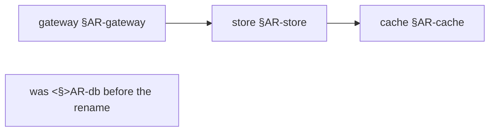

# Fenced citations: a Mermaid diagram whose labels are checked

This runnable mini-repository is for a project that draws its architecture inline, in a ```` ```mermaid ```` fence that GitHub and editor previews render as a diagram, and cites in each label the component it draws. Every Markdown fence is an illustration by default, so those citations would go unread. `[schema.sources] fenced` names the fences whose citations are read ([§FS-config-v2.schema.sources.fenced](../../docs/functional-spec/FS-config-v2.md#schemasourcesfenced-fenced-names-the-fences-whose-citations-are-read)). The guide is [Reading the citations in a diagram fence](../../docs/user-facing/sources.md#reading-the-citations-in-a-diagram-fence).

The configuration, in full:

```toml
grund_config_version = 2
project_name = "fenced-citations-example"

[schema.sources]
# Read the citations in every ```mermaid fence; every other fence stays an illustration.
fenced = ["mermaid"]

[schema.kinds.AR]
files = ["docs/ar.md"]
```

`docs/ar.md` declares two components, `AR-gateway` and `AR-store`. `docs/overview.md` draws them, and a cache that was never declared:

````markdown


A fence the configuration does not name is still an illustration:

```text
gateway §AR-cache
```
````

Run it from the repository root:

```bash
grund check examples/fenced-citations/repo
echo $?    # 1
```

stdout is the golden below; stderr is empty:

```text
docs/overview.md:9: error: unknown reference AR-cache
```

What each line of the diagram does:

- **A label's citation is a use.** `AR-gateway` and `AR-store` are cited only in the diagram, and neither is reported as never cited ([§FS-languages.fence.language](../../docs/functional-spec/FS-languages.md#fencelanguage-a-fences-tag-and-the-fences-fenced-selects)).
- **A dangling label is caught.** The cache has no declaration, so the label on line 9 is an unknown reference, as it would be in prose.
- **An escape is no citation.** The note writes the old name as `<§>AR-db`, so it is shown and not checked.
- **Another fence stays an illustration.** The ```` ```text ```` fence cites the same missing ID and draws nothing, because its tag is not in the list ([§FS-citations.recognized.contexts](../../docs/functional-spec/FS-citations.md#recognizedcontexts-contexts-read-as-neither-prose-nor-code)).

Delete the `fenced` line and run `check` again: the cache label passes unread, and both declarations the diagram cites are reported as never cited. Declaring `AR-cache` instead turns the run green. `grund fmt --write` never rewrites a byte inside either fence, because a Markdown link inside a Mermaid label breaks the diagram.
