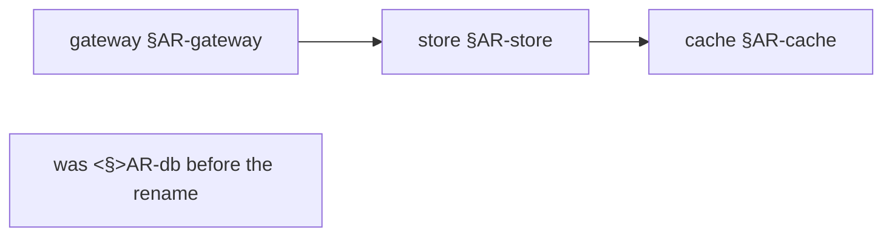

# Architecture

The diagram renders on GitHub and in editor previews, and each label cites the
component it draws.



A fence the configuration does not name is still an illustration:

```text
gateway §AR-cache
```
