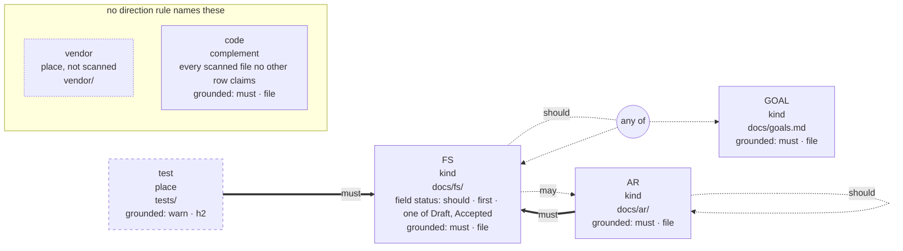

# Schema: what a repository is held to, at a glance

This runnable mini-repository demonstrates [§FS-schema](../../docs/functional-spec/FS-schema.md#fs-schema-grund-schema-shows-what-a-repository-is-held-to-read-from-its-configuration-alone):
`grund schema` reads a `grund.toml` and prints its kinds and places, the shape of
each kind's declarations, which units must be grounded, and who must cite whom and
how strongly. It reads the configuration alone, so it answers before a single
declaration is written, and on a tree whose citations are broken.

Run it from the repository root:

```bash
grund schema examples/schema/repo
echo $?    # 0
```

The config has three kinds, a test folder, an unscanned vendor folder, one field
and four citation rules. The view it prints:

```text
example · grund.toml · v2

kinds and places
  GOAL    kind                docs/goals.md
  FS      kind                docs/fs/
            field status      should · first · one of Draft, Accepted
  AR      kind                docs/ar/
  test    place               tests/
  vendor  place, not scanned  vendor/
  code    complement          every scanned file no other row claims

citations                     grounded
  GOAL    —                   must · file
  FS      should  GOAL|FS     must · file
          may     AR
  AR      must    FS          must · file
          should  AR (itself)
  test    must    FS          warn · h2
  code    —                   must · file
  vendor  not scanned: cites nothing and is never checked

must = check error · warn = check warning · should = suggestion (check --suggestions)
may = allowed · must not / warn not / should not = forbidden at that strength
A|B = one obligation, met by citing either · — = no direction rule names it
```

Read it row by row:

- **GOAL, FS, AR** are kinds: they declare IDs. **test** is a place: its files cite
  and are checked, but declare nothing. **vendor** is not scanned at all, and
  **code** is the complement, every other scanned file.
- `field status` is FS's one field: should be present, first, and say `Draft` or
  `Accepted`.
- `GOAL|FS` is **one** obligation, met by citing either. `AR (itself)` is a kind
  citing its own kind, and FS and AR cite each other: a cycle is shown as it is.
- The `grounded` column is the grounding each row is held to: the project's
  `must · file`, except `test`, whose own ladder asks for a `warn` per `h2`.

`--format mermaid` prints the same facts as Mermaid source, which GitHub draws:



`--format dot` prints Graphviz source, for `grund schema --format dot | dot -Tsvg > schema.svg`.
grund runs neither program.

For the TOML, `grund config show` prints what applies, `grund config explain`
every setting; `grund schema` is the picture of what that TOML holds a
repository to.
